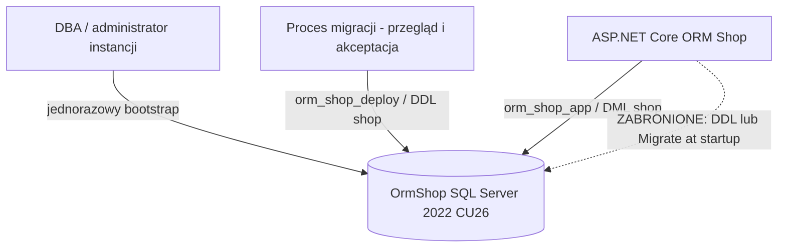

# Architektura i model uprawnień — ORM Shop

## Zasada podstawowa

**Aplikacja nie uruchamia migracji.** Każda zmiana schematu jest oddzielnym etapem deploymentu, wykonywanym na tożsamości **orm_shop_deploy** po przeglądzie wygenerowanego SQL. Konto **orm_shop_app** ma wyłącznie uprawnienia DML potrzebne do działania aplikacji. **sa** wykorzystujemy tylko do przygotowania izolowanej instancji laboratoryjnej i utworzenia ról/loginów — nigdy w connection stringu aplikacji.

| Tożsamość | Przeznaczenie | Uprawnienia | Zakaz |
|---|---|---|---|
| sa (bootstrap) | tworzy DB, schema, loginy i role | administrator tylko podczas bootstrapu | użycie w aplikacji |
| orm_shop_deploy | kontrolowane migracje | CREATE TABLE i inne wybrane CREATE w bazie oraz ALTER, REFERENCES i DML na schemacie shop | sysadmin, db_owner, ALTER na schematach innych niż shop |
| orm_shop_app | uruchomiona aplikacja | SELECT/INSERT/UPDATE/DELETE w schemacie shop | CREATE/ALTER/DROP, db_owner |
| student | przegląd kodu | Git read i lokalne środowisko | commitowanie sekretów |

*Model uprawnień jest laboratorium, nie gotowym szablonem produkcyjnym.* `CREATE TABLE` jest uprawnieniem bazodanowym, ale nowy obiekt wymaga też `ALTER` na schemacie docelowym. Deploy ma `ALTER` tylko na `shop`, więc `CREATE TABLE dbo.ShouldFail` ma się nie udać. Dla kolejnej migracji sprawdzamy każde DDL i nie poszerzamy roli na stałe. Skrypt `02-create-logins.sql` można uruchomić ponownie: istniejący login dostaje hasło z `:setvar`, a powtórne członkostwo w roli jest pomijane. Hasło w `:setvar` nie może zawierać apostrofu.

## Kolejność i separacja

1. DBA wykonuje `security/01-bootstrap.sql`.
2. DBA tworzy loginy i role za pomocą `security/02-create-logins.sql` (zwykły T-SQL w VS Code; hasła inne dla obu kont, nigdy nie zapisuj pliku z rzeczywistymi hasłami).
3. DBA weryfikuje role poleceniami z `security/03-verify-permissions.sql`.
4. Prowadzący generuje migrację `dotnet ef migrations add ...` oraz skrypt `dotnet ef migrations script --idempotent -o ...`.
5. Skrypt jest sprawdzany pod kątem DROP, ALTER, blokad, utraty danych, transakcyjności i odtwarzania.
6. Zatwierdzoną migrację uruchamia **konto deploymentu**, nie aplikacja.
7. API korzysta z konta runtime i sprawdza, że nie może wykonać DDL.

## Sekrety

- `.env` Dockera tylko do bootstrapu (sa), ignorowany przez Git.
- Connection strings do EF Core przechowuj w **dotnet user-secrets** podczas developmentu lub w secret store w innych środowiskach; nigdy w kodzie, plikach version-controlled ani notatkach.
- Stosuj Encrypt=True. W izolowanym laboratorium z niezaufanym certyfikatem można użyć TrustServerCertificate=True; nie jest to docelowe ustawienie produkcyjne.
- Hasła nie mogą być udostępnione grupie ani powielane między studentami.

## Negatywne testy bezpieczeństwa

- Zaloguj się jako app → `SELECT` na istniejącym obiekcie `shop` działa.
- Zaloguj się jako app → próba `CREATE TABLE shop.Denied(...)` musi zakończyć się odmową.
- Jako app → `ALTER TABLE` musi zostać odmówione.
- Jako app → próba modyfikacji schematu `dbo` musi zostać odmówiona.
- Jako deploy → migracja w `shop` działa po zatwierdzeniu, a `CREATE TABLE dbo.ShouldFail` jest odrzucone. Nie przyznajemy `db_owner` jako szybkiej naprawy.
- Brak `Database.Migrate()` i `MigrateAsync()` w uruchomieniu API.

Jeżeli skrypt migracji nie przechodzi z ograniczonym kontem, ustal **konkretną brakującą operację i uprawnienie**; nie poszerzaj konta na stałe. Bootstrap nie jest procesem odtwarzania produkcyjnego.

## Materiały odniesienia

- [EF Core: Applying Migrations](https://learn.microsoft.com/en-us/ef/core/managing-schemas/migrations/applying)
- [SQL Server: Permissions](https://learn.microsoft.com/en-us/sql/relational-databases/security/permissions-database-engine)
