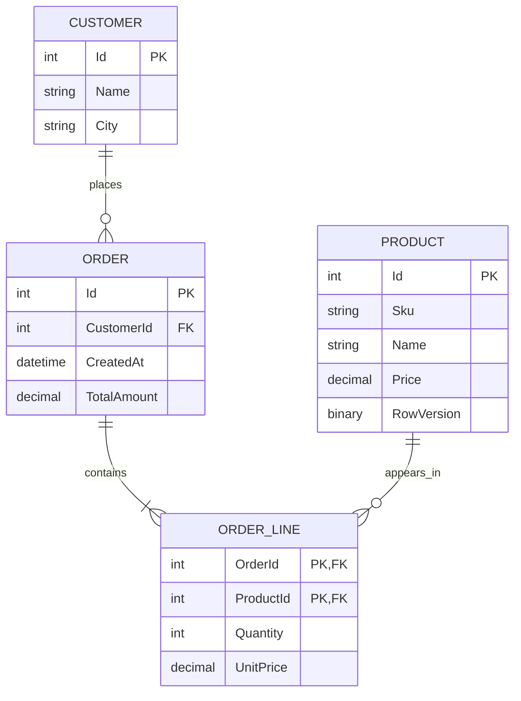
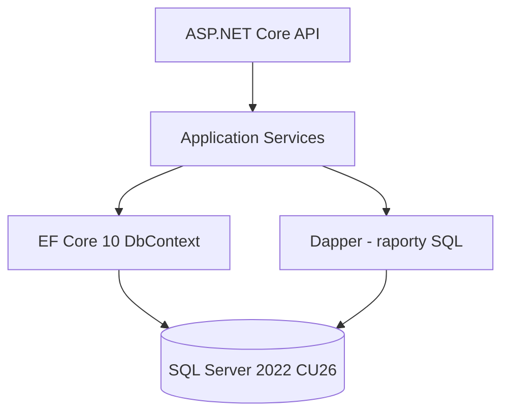

# ORM Shop — wspólne studium przypadku (wykłady 01–08)

## Kontekst
Sklep przyjmuje zamówienia klientów. System pokazuje katalog produktów, umożliwia zakup i udostępnia raporty sprzedaży. **To model dydaktyczny**, nie gotowy system produkcyjny.

## Model

## Architektura

## Ślad studium przypadku
| Wykład | Rozwijany problem |
|---|---|
| 01 | Trzy sposoby uzyskania listy klientów: ADO.NET, Dapper, EF Core |
| 02 | Model, DbContext, mapowanie, migracja Price decimal(18,2), SKU UNIQUE |
| 03 | Customer–Order–OrderLine–Product i konsekwencje FK |
| 04 | Lista 100 klientów z zamówieniami, paginacja i generowany SQL |
| 05 | Zmiana ceny produktu: tracking vs aktualizacja odłączonego DTO |
| 06 | Dwóch użytkowników zmienia cenę; rowversion i transakcja zamówienia |
| 07 | Raport zamówień: N+1, projekcja, indeksy, pomiary IO i planu |
| 08 | Dobór EF Core/Dapper, test na SQL Server, strategia deploy |

## Reguły pracy
- Za każdym razem pokazuj kod C#, przewidywany kształt SQL oraz sposób **sprawdzenia rzeczywistego SQL**.
- Nie nazywaj przykładowego SQL dosłownym wynikiem providera, dopóki nie został uruchomiony na referencyjnej wersji EF Core.
- W testach integracyjnych używaj referencyjnego SQL Server zamiast zakładać zgodność z providerem InMemory.
- Dane testowe są syntetyczne. Żadnych prawdziwych danych klientów.
